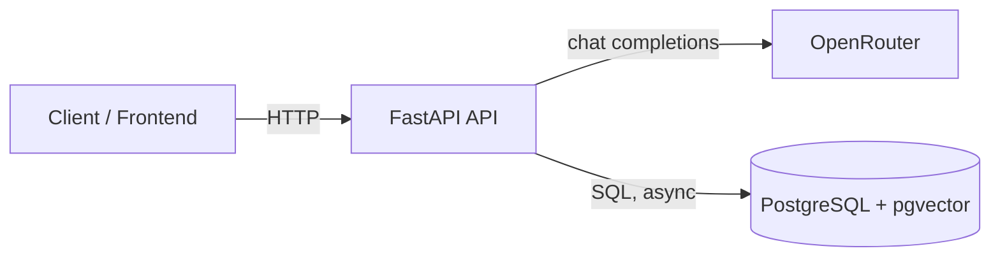
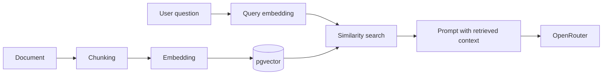

# Architecture

## Goals

Build a production-shaped chat API (ChatGPT/Claude style) incrementally:

- **V1:** chat completions through OpenRouter, persisted conversations, JWT authentication.
- **V2:** Retrieval-Augmented Generation over user-provided documents.

## Current state

The repository is a V1 boilerplate. The runtime, container setup and configuration layer exist. The only routes are `GET /` and `GET /health`. SQLAlchemy, asyncpg and Alembic are installed but not yet used.

## System context



| Component | Responsibility |
|---|---|
| FastAPI API | HTTP interface, validation, orchestration |
| OpenRouter | Single gateway to many LLM providers |
| PostgreSQL | Relational data now (users, conversations, messages); vector storage in V2 |

## Runtime topology

Two Compose services:

- `api`: built from the `Dockerfile` (`builder` stage). Source is bind-mounted at `./app:/app/app` and Uvicorn runs with `--reload`. `WATCHFILES_FORCE_POLLING` is enabled so reload works on Windows bind mounts.
- `db`: `pgvector/pgvector` image (PostgreSQL 17) with a named volume `postgres_data`. A healthcheck (`pg_isready`) gates API startup via `depends_on: condition: service_healthy`.

The current Compose setup is a development environment. A production image would need its own build stage, no bind mount, no `--reload`, and secrets injected by the platform.

## Planned code layout

Not implemented yet; this is the intended direction so V1 does not block V2.

```
app/
├── main.py        # app factory, router registration
├── config.py      # Settings
├── api/           # routers (HTTP layer only)
├── schemas/       # Pydantic request/response models
├── services/      # business logic (chat orchestration, auth)
├── db/            # engine, session, models
└── clients/       # external integrations (OpenRouter)
```

Principles:

- Routers stay thin: parse, call a service, return.
- Services depend on abstractions of external systems (the OpenRouter client), so they can be tested with fakes.
- All I/O is async end to end (FastAPI, SQLAlchemy asyncio, asyncpg, an async HTTP client).

## Planned data model (V1)

Subject to change when persistence is implemented.

- `users`: identity and credentials
- `conversations`: owned by a user
- `messages`: belong to a conversation; role (`system`/`user`/`assistant`), content, timestamps

Schema changes go through Alembic migrations.

## V2: RAG



Design implications already honored in V1:

- The database image already ships pgvector, so enabling the extension is a migration, not an infrastructure change.
- Embeddings and relational data live in one database, avoiding a second datastore and cross-system consistency issues.
- The chat service is isolated behind a service layer, so a retrieval step can be added before the model call without changing the HTTP contract.

Open questions for V2: embedding model and dimension, chunking strategy, per-user document isolation, ingestion as a background job.

## Non-goals (V1)

- Streaming responses (likely a fast follow)
- Multi-tenant organizations and roles
- Rate limiting and usage billing
- Horizontal scaling and production deployment manifests

## Related documents

- [DECISIONS.md](../DECISIONS.md): why these technologies were chosen
- [CONFIGURATION.md](CONFIGURATION.md): environment variables
