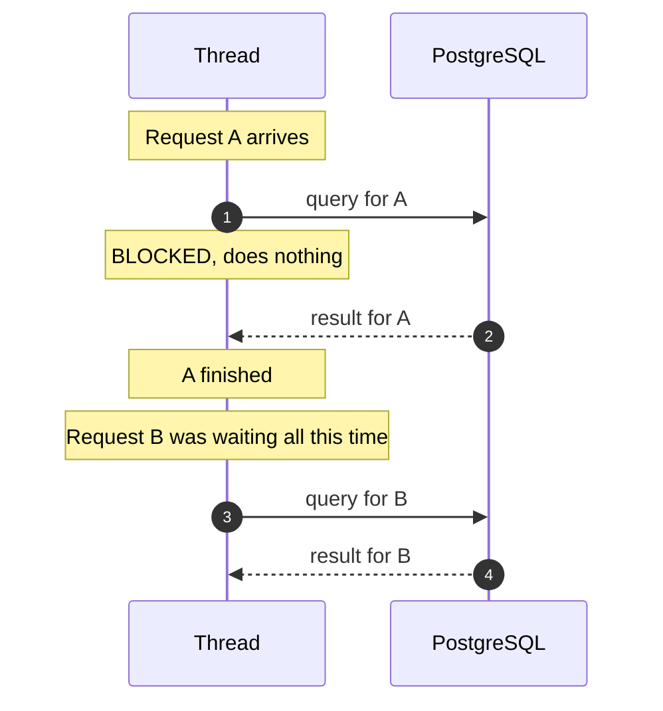
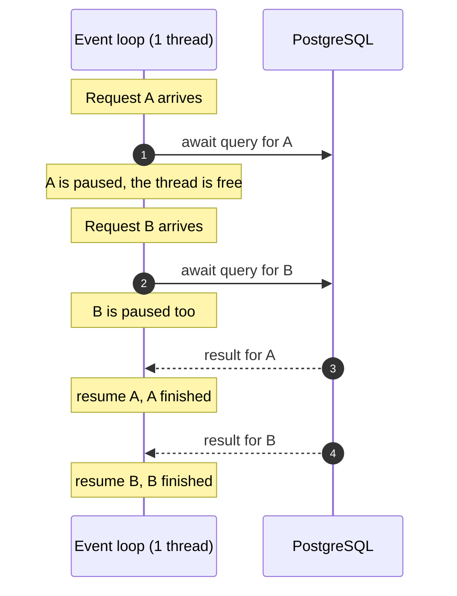
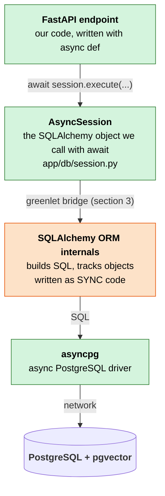
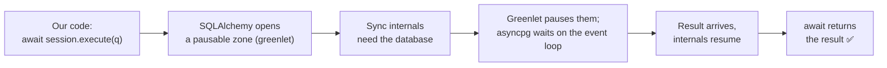
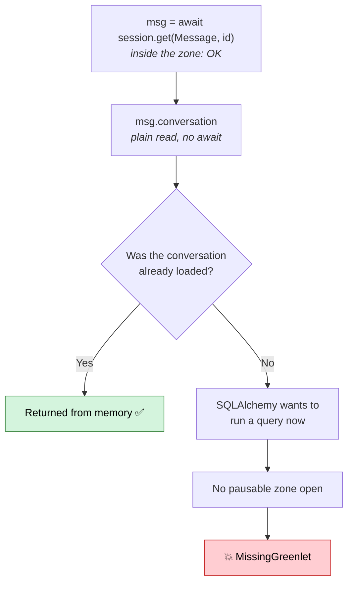
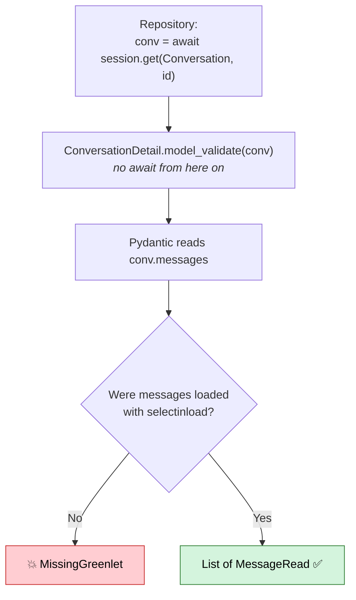

# Async in this project

How this API handles many requests at once, how the database layer fits in, and why one specific error (`MissingGreenlet`) shapes the way the code is written.

No prior Python or FastAPI knowledge is assumed. Read it top to bottom: each section builds on the previous one.

## Glossary

Keep this handy. Every term is explained again in context below.

| Term | Plain meaning |
| --- | --- |
| **Request** | One call from a client to the API, for example "give me conversation 42". |
| **I/O** | Input/output: anything that talks to something outside the program (database, network, disk). It is slow compared to normal code. |
| **Thread** | A worker that executes code, one instruction after another. |
| **Blocking** | A thread that sits idle waiting for I/O and cannot do anything else meanwhile. |
| **`async def`** | Python syntax for a function that is allowed to pause while it waits for I/O. |
| **`await`** | The pause point inside an `async def`: "this will take a while, do other work and come back when it is ready". |
| **Event loop** | The scheduler that decides which paused function runs next. It runs on a single thread. |
| **FastAPI** | The web framework: it receives HTTP requests and calls our Python functions (called *endpoints*). |
| **Uvicorn** | The server program that runs FastAPI and owns the event loop. |
| **SQLAlchemy** | The library that turns Python objects (`Conversation`, `Message`) into SQL queries. This mapping is called an **ORM**. |
| **Driver** | The low-level library that actually speaks the PostgreSQL network protocol. Here it is `asyncpg`. |
| **Pydantic** | The library that validates data and converts Python objects into JSON responses. Its classes are called *schemas*. |

## 1. Sync vs async: the problem async solves

Analogy: a restaurant with **one waiter**.

- **Sync (blocking) waiter:** takes table A's order, walks to the kitchen and stands there until the dish is ready. Tables B and C wait, even though the waiter is doing nothing.
- **Async waiter:** takes table A's order, hands it to the kitchen, and serves tables B and C while the food cooks. When the dish is ready, the waiter goes back to A.

An API request spends most of its time waiting: for PostgreSQL (milliseconds) or for the LLM (often 10 seconds or more). That waiting is the kitchen.

### Sync: the thread is stuck while it waits



### Async: the thread serves someone else while it waits



Both requests are "in the kitchen" at the same time, with a single thread.

### The catch: one blocking call freezes everyone

The event loop has only one thread. If code inside an `async def` waits **without** `await` (for example `time.sleep(5)` or the `requests` HTTP library), the thread is stuck and **every** request in the API stops until it finishes. That is why `docs/ROADMAP.md` forbids blocking libraries inside `async def` and asks for `httpx.AsyncClient` instead of `requests`.

| | Sync | Async |
| --- | --- | --- |
| Function syntax | `def` | `async def` |
| Waiting for I/O | Thread is blocked | `await` frees the thread |
| Many slow requests | Need many threads | One thread handles them |
| Danger | Slow under load | A single blocking call freezes the whole API |

> FastAPI detail: an endpoint written with plain `def` is run in a separate pool of threads, so blocking there does not freeze the loop. The bug only happens when blocking code is placed inside an `async def`. This project uses `async def` everywhere, so blocking calls are never allowed.

## 2. The layers in this project

A database call travels through four layers. The diagram reads top to bottom: our code at the top, the database at the bottom.



Green layers are async, orange is sync. The orange one in the middle is the interesting part.

- **asyncpg** is the driver. It talks to PostgreSQL over the network and it is async. The alternative, `psycopg2`, is sync and would block the event loop. The driver is chosen by the start of the connection URL: `postgresql+asyncpg://...` (see `app/config.py` and `.env.example`).
- **AsyncSession** is what our code uses. Every call that may reach the database is awaited: `await session.execute(...)`, `await session.get(...)`, `await session.commit()`.
- **SQLAlchemy ORM internals** were written long before async existed. Async support was added **around** them, not by rewriting them. So sync code in the middle has to call an async driver below it. That needs a bridge.

## 3. Greenlet: the bridge

Normally, sync code cannot pause to let the event loop run something else. `greenlet` is a small library that gives sync code that ability, with one condition: it only works inside a "pausable zone" that SQLAlchemy opens beforehand.

That zone is opened every time we `await` a session method.



`greenlet` is installed automatically by the `sqlalchemy[asyncio]` dependency in `pyproject.toml`.

## 4. `MissingGreenlet`: what it is

It is the error raised when SQLAlchemy needs the database but **no pausable zone is open**, because the code that triggered it did not use `await`.

```text
sqlalchemy.exc.MissingGreenlet: greenlet_spawn has not been called;
can't call await_only() here. Was IO attempted in an unexpected place?
```

The classic trigger is **lazy loading**. Our models have relationships:

- `Message.conversation`: the conversation a message belongs to.
- `Conversation.messages`: the list of messages in a conversation.

By default SQLAlchemy does not load a relationship until someone reads it. Reading it (`msg.conversation`) is a plain attribute access, with no `await`. In sync SQLAlchemy that silently runs a query. In async there is no pausable zone at that point, so it fails.



Rule of thumb: **every database access must happen inside an `await`.** Anything read afterwards must already be in memory.

## 5. Why it matters for our schemas

Pydantic schemas (`app/schemas/`) turn database objects into JSON. With `from_attributes=True`, Pydantic simply reads attributes from the object: `obj.id`, `obj.title`, `obj.messages`... These are plain reads, with no `await`. If one of them is an unloaded relationship, Pydantic triggers a lazy load without knowing it, and `MissingGreenlet` appears in the middle of building the response.



How the project avoids it:

- **`MessageRead` exposes `conversation_id`, not a nested `conversation`.** `conversation_id` is a regular column, always loaded with the message. No relationship is read, so there is no risk.
- **The future `ConversationDetail` (with its messages) must load them up front.** The repository uses `selectinload(Conversation.messages)` in the query. SQLAlchemy then runs a second query **inside the `await`**, and when Pydantic reads `conv.messages` they are already in memory.
- **`expire_on_commit=False` in `app/db/session.py:6`.** By default, after `await session.commit()` SQLAlchemy marks every attribute as stale. The next read, even `conv.title`, would query the database again, outside any `await`, and raise `MissingGreenlet`. This setting keeps the values in memory after a commit. Without it, the first create endpoint (Phase 5 in `docs/ROADMAP.md`) would fail when returning the newly created object.

## Summary

| Concept | What it is | Where it lives in this project |
| --- | --- | --- |
| Event loop | One thread that switches between requests at every `await` | Run by Uvicorn, used by FastAPI |
| `async def` / `await` | A function that can pause / the pause point | Every endpoint and repository function |
| asyncpg | Async PostgreSQL driver | `postgresql+asyncpg://` in `DATABASE_URL` |
| AsyncSession | SQLAlchemy object used with `await` | `DBSession` and `get_db()` in `app/db/session.py` |
| greenlet | Bridge that lets SQLAlchemy's sync internals pause for the async driver | Installed by `sqlalchemy[asyncio]` |
| Lazy loading | Loading a relationship only when it is read | Default for `Conversation.messages` and `Message.conversation` |
| `MissingGreenlet` | Database access attempted outside an `await`, usually a lazy load | Avoided with `conversation_id`, `selectinload` and `expire_on_commit=False` |
